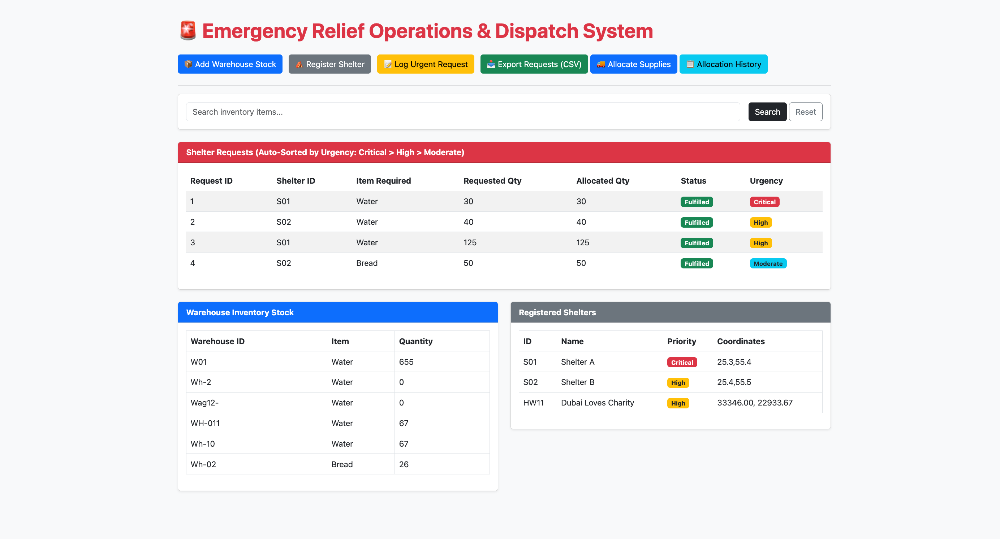
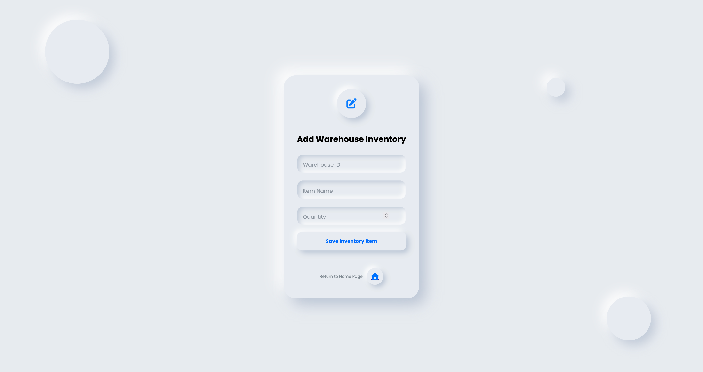
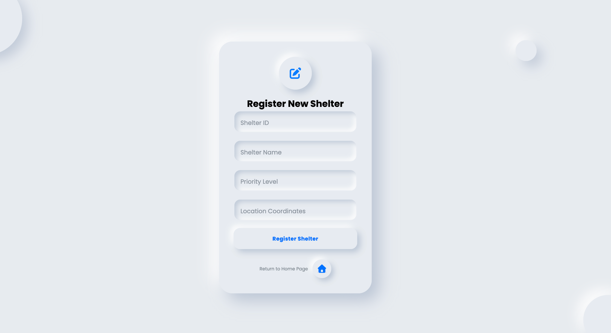
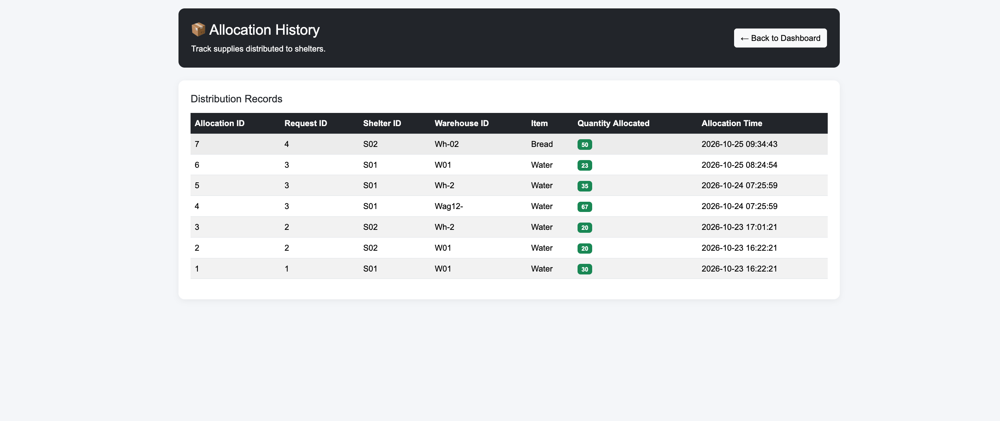

# 🚨 Emergency Relief Operations & Dispatch System

A Flask-based web application for managing emergency supplies, shelter
requests, and priority-based distribution across warehouses.

<div align="center">
  <a href="https://vimeo.com/1240305559">
    
  </a>
</div>

## Screenshots

### Main Dashboard



### Add Warehouse Inventory



### Add Shelters



### Allocation History



## File Tree Outline

``` text
Emergency-Relief-Dispatch-System/
├── app.py
├── db.py
├── templates/
├── static/
├── docs/
│   └── screenshots/
│       ├── dashboard.png
│       ├── inventory.png
│       ├── shelters.png
│       ├── requests.png
│       └── allocation-history.png
└── README.md
```

## Features

-   **Inventory management:** Track supplies by warehouse and item.
-   **Shelter management:** Store shelter details, priorities, and
    coordinates.
-   **Request management:** Record supply requests with Critical, High,
    or Moderate urgency.
-   **Priority-based allocation:** Allocate available stock to
    higher-urgency requests first.
-   **Allocation history:** View recorded distributions, including the
    warehouse, shelter, item, quantity, and time.
-   **Inventory search:** Filter inventory by item name.
-   **CSV export:** Export shelter request records for reporting.
-   **Dashboard:** View inventory, shelters, and prioritized requests in
    one place.

## Built With

-   Python
-   Flask
-   SQLite
-   HTML and CSS
-   Bootstrap

## Getting Started

### 1. Clone the repository

``` bash
git clone https://github.com/rayancheema/Emergency-Relief-Dispatch-System.git
cd Emergency-Relief-Dispatch-System
```

### 2. Install Flask

``` bash
pip install flask
```

If the project includes a `requirements.txt` file, you can instead
install its dependencies with:

``` bash
pip install -r requirements.txt
```

### 3. Run the application

``` bash
python app.py
```

Open **http://127.0.0.1:5000** in your browser.

## Notes

This project is an educational emergency-relief management system. It is
not intended to replace professional emergency-response or dispatch
infrastructure.
